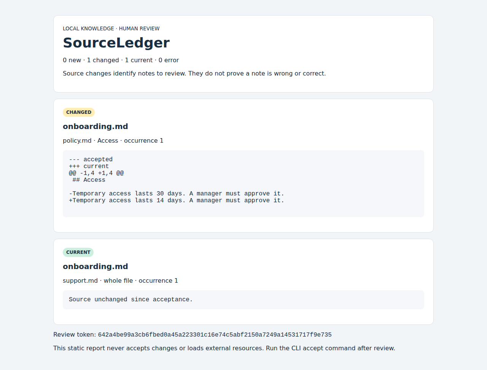

[简体中文](README.zh-CN.md)

# SourceLedger

**Know which notes need another look when their sources change.**

SourceLedger is a local-first review queue for Markdown handbooks, runbooks, research notes, and agent knowledge folders. Declare which local sources a note depends on. Review exact source diffs. Explicitly accept the snapshot after checking the affected note.

It does not rewrite your notes, call an LLM, fetch URLs, or decide whether a statement is factually correct.



[Mobile screenshot](docs/images/report-mobile.png) · [Actual HTML example](docs/example-report.html)

## Try a complete example

Python 3.10+ and Git are required. No runtime dependencies or service accounts.

Linux / macOS:

```sh
git clone https://github.com/keweizhuazuki/sourceledger.git
cd sourceledger
python3 -m venv .venv
. .venv/bin/activate
python -m pip install -e .
python examples/demo.py
```

Windows PowerShell (activation is optional):

```powershell
git clone https://github.com/keweizhuazuki/sourceledger.git
cd sourceledger
py -3 -m venv .venv
.venv\Scripts\python.exe -m pip install -e .
.venv\Scripts\python.exe examples\demo.py
```

The demo copies a tiny handbook into a temporary directory, accepts its initial sources, changes the access duration from 30 to 14 days, and creates `demo-report.html` in your current folder. Open it in a browser. A second run refuses to overwrite that report; move it first. The original examples stay unchanged. You can also run `python -m sourceledger` from the checkout without installation.

Expected useful output:

```text
0 new, 1 changed, 1 current, 0 error

[CHANGED] onboarding.md ← policy.md → Access [1]
--- accepted
+++ current
@@ -1,4 +1,4 @@
 ## Access
 
-Temporary access lasts 30 days. A manager must approve it.
+Temporary access lasts 14 days. A manager must approve it.
```

On Windows without activation, replace `sourceledger` in the commands below with `.venv\Scripts\sourceledger.exe` (from the checkout), or use the full path to that executable from another folder. `python -m pip install .` (or `.venv\Scripts\python.exe -m pip install .` on non-activated Windows) also supports a normal, non-editable installation; the installed CLI can run outside the checkout. Git is needed for cloning and `suggest-renames`, not for ordinary local reviews.

## Use your existing knowledge base

1. Run `sourceledger --root /path/to/notes init`.
2. Edit the generated `sourceledger.json` to describe actual dependencies. Paths are relative to that folder, with forward slashes on all platforms.
3. Run `sourceledger --root /path/to/notes headings sources/policy.md` to find exact heading names and duplicate occurrences.
4. Run `sourceledger --root /path/to/notes check`. New dependencies require an initial review, just like changed sources.
5. Review the affected notes and the source diff. Edit your notes yourself if needed, then run `check` again to obtain a fresh token.
6. Accept exactly that review with `sourceledger --root /path/to/notes accept --token TOKEN`.

```json
{
  "version": 1,
  "dependencies": [
    {"note": "notes/onboarding.md", "source": "sources/policy.md", "heading": "Access", "occurrence": 1},
    {"note": "notes/onboarding.md", "source": "sources/support.md"}
  ]
}
```

Omit `heading` to watch the whole UTF-8 file. A heading watches its complete section including subsections, up to the next same-or-higher-level heading. Editing unrelated sections does not flag this dependency. Headings are exact, case-sensitive ATX titles (`#` through `######`); duplicate titles use 1-based `occurrence` in document order. Fenced-code headings are ignored. Setext headings, HTML headings, and rendered Markdown slug interpretation are not supported.

### Review one note or export a report

```sh
sourceledger --root ./handbook check --note notes/onboarding.md
sourceledger --root ./handbook accept --note notes/onboarding.md --token TOKEN
sourceledger --root ./handbook check --format html --output review.html
sourceledger --root ./handbook check --format json --output review.json
```

Use the same `--note` selection for checking and acceptance. A token changes when selected source content, note content, dependency identity, or its accepted baseline changes. A token is a stale-review guard, not a password or signature. Existing output files are never overwritten. CLI output and saved reports use UTF-8.

Invalid knowledge-base roots (missing folders, regular files, inaccessible paths or symlink loops) produce an operation error rather than a review-needed result.

Exit codes: `0` all selected sources current / action succeeded; `1` new or changed sources require review; `2` invalid configuration, missing source/note/section, unreadable file, or operation error. A missing or renamed source is an error, never an accepted deletion. Correct the path deliberately and review the new dependency.

## Discover candidates from existing Markdown links

```sh
sourceledger --root ./handbook discover notes/onboarding.md
sourceledger --root ./handbook discover notes/onboarding.md notes/support.md --format json --output proposal.json
python -m sourceledger --root examples discover discovery/note.md
```

Discovery reads only the named notes and linked local UTF-8 files. It does not create/open the baseline database, modify your manifest, accept sources, or fetch URLs. It produces deduplicated candidates with manifest-ready `dependency` objects, original line numbers/destinations, and source/note hashes; skipped destinations include reasons. See the [actual mixed-case example](docs/discovery-example.txt).

Review the report and copy only the chosen `dependency` objects into the `dependencies` array in `sourceledger.json` (or run `init` first). Then run `check`, review the actual source snapshots, and explicitly `accept` a fresh token. A discovery proposal has a separate `kind` and is deliberately rejected as a manifest. The command refuses to write `sourceledger.json` or overwrite any existing proposal file. There is no automatic apply step; discovered links may be navigation or otherwise irrelevant to the note's claims.

Supported discovery subset:

- Ordinary single-line inline links, such as `[policy](../sources/policy.md#access)`, angle-bracket destinations with spaces, percent-encoded UTF-8 paths/fragments, balanced/escaped destination parentheses, and optional single/double-quoted titles.
- Paths resolve relative to the note, stay within the selected root, and point to readable UTF-8 files. Identical dependencies are grouped while retaining every source line.
- Fragment matching uses a conservative literal-heading profile: Unicode letters/numbers, ASCII spaces, hyphens, intraword underscores and literal ASCII punctuation `.,;:!?"'()/`. Lowercase titles remove that punctuation and replace each space with a hyphen; collisions append `-1`, `-2`, etc. in document order, skipping used slugs. Proposed dependencies preserve the exact raw ATX title and its occurrence, not the generated slug. Underscore runs are supported only between letters/numbers (`api_key`, `api__key`); `_Access_` is rejected as potentially formatted Markdown. Every target heading must pass validation before any fragment can match.
- This bounded profile follows [GitHub’s documented section-link rules](https://docs.github.com/en/get-started/writing-on-github/getting-started-with-writing-and-formatting-on-github/basic-writing-and-formatting-syntax#section-links) for the listed literal forms. [CommonMark parses ATX heading content as inline Markdown](https://spec.commonmark.org/0.31.2/#atx-headings), so this is not general GitHub/Obsidian/other renderer equivalence. HTML/comment markup, containers, Setext headings, inline formatting/code/links/entities/escapes, emoji-shortcode-like text, non-ASCII punctuation, punctuation-only empty anchors and unknown fragments require manual `headings` inspection and explicit configuration.
- Fenced/indented code, inline-code spans and HTML comments are ignored. Raw/inline HTML, reference/wiki-link lines, multiline links/titles, images, query strings, external schemes, and same-document navigation are skipped or reported as unsupported. This is a bounded parser, not complete CommonMark; complex/nested link labels and unmatched delimiters require manual inspection. It may conservatively skip an entire unsupported line/block.

Literal examples: `Install (Linux/macOS)` → `#install-linuxmacos`, `What's new?` → `#whats-new`, `Version 2.0` → `#version-20`. Run `python -m sourceledger --root examples/discovery discover anchor-note.md` for the [actual synthetic example](docs/anchor-example.txt), including colliding headings and explicitly skipped emphasis. These remain proposals for review; no manifest or baseline is changed.

Discovery exits `0` when a report is produced, even with skipped links, or `2` for an invalid requested note/output operation. Candidates are suggestions, never proof of completeness or factual dependency. Source changes after discovery are evaluated by the ordinary `check`/`accept` flow.

## Suggest replacements after a staged Git rename

```sh
sourceledger --root ./handbook suggest-renames
sourceledger --root ./handbook suggest-renames --format json
python examples/rename_demo.py
```

A repeatable problem: after `git mv policy.md access-policy.md`, the old manifest source is missing and `check` correctly fails. This command helps locate possible replacements using only existing local Git metadata. The [actual disposable demo](docs/rename-example.txt) reproduces the error and verifies the manifest, Git index and baseline database stay byte-identical during suggestion.

For each missing note/source path, it joins **staged regular-file deletions and additions with exactly the same Git blob ID** relative to HEAD. All matching in-root, readable UTF-8 destinations are displayed. Multiple additions or deletions sharing a blob are marked ambiguous; one candidate is still only a suggestion, not proof of a rename. Required source sections must exist in the current candidate file. JSON includes current normalized-text hashes, while the exact-identity evidence applies to the staged blobs: working files can have unstaged edits.

Review the paths and current content, edit the manifest yourself, then run `check` and explicitly accept the newly identified dependencies. Old baselines/history are not transplanted. Existing paths are never suggested for replacement.

Boundaries: no similarity guessing, unstaged/untracked moves, already-committed rename search, binary files, symlink/submodule entries, remote Git operations or mutation. Git must be installed, HEAD must exist, the root must be inside a local working tree, and paths must be UTF-8. A missing path with no exact staged match remains unresolved. Symlinks escaping the selected root and unreadable/missing-section candidates are rejected. Repository roots containing line breaks and missing paths traversing symlink aliases are unsupported.

Git runs with external diffs, text conversion, hooks, filesystem-monitor hooks, lazy fetching, transports, inherited Git overrides and optional writes disabled for that child process. User/repository settings are not changed. Commands have a 10-second timeout and reject metadata output above 8 MiB. This is a local helper, not a sandbox for a malicious Git installation or a concurrently manipulated working tree. Exit `0` means a report was produced, including unresolved cases; `2` means configuration/Git inspection failed.

## Inspect acceptance history

```sh
sourceledger --root ./handbook history
sourceledger --root ./handbook history --note notes/onboarding.md --limit 5
sourceledger --root ./handbook history --before 12 --limit 5
sourceledger --root ./handbook history --format json
```

Every successful `accept` now records one batch with a UTC timestamp, review token, selection scope, and each accepted dependency's revision, exact source snapshot, previous snapshot, and note hash. Text shows source identities and SHA-256 fingerprints; JSON includes the saved source text. History never rereads sources or needs a valid manifest, so removed/renamed files and removed dependencies remain inspectable.

Newest batch IDs come first. `--limit` accepts 1–100 batches (default 20); `--before` provides stable pagination while new acceptances arrive. With `--note`, both batches and their displayed entries are filtered to that exact note. Keep that filter when following the next-page hint. Reaccepting unchanged content records an additional explicit review and advances its revision.

Old databases migrate automatically without changing existing baselines or their revisions. Earlier acceptance times were never stored and are not invented: history begins with the next successful acceptance. Failed or stale acceptance writes neither a batch nor partial history. Timestamps use the local machine's UTC clock; this is local review evidence, not a signed or tamper-proof audit log. The database stores repeated source snapshots and grows over time; there is no automatic retention/pruning. Back it up and treat JSON history exports as potentially sensitive.

The [runnable demo output](docs/demo-output.txt) includes a real initial acceptance record; its timestamp and token are examples, not values to reuse.

## Portable baselines for offline CI

After a normal human review and `accept`, export the accepted state:

```sh
sourceledger --root ./handbook export-baseline --output reviewed-baseline.json
sourceledger --root ./fresh-checkout check --baseline reviewed-baseline.json
sourceledger --root ./fresh-checkout check --baseline reviewed-baseline.json --format html --output ci-review.html
python examples/baseline_demo.py
```

Windows without activation: use `.venv\Scripts\sourceledger.exe` and `.venv\Scripts\python.exe` from the checkout. Snapshot/report paths are relative to the current working directory; note/source paths remain relative to `--root`.

Export includes only previously accepted source text and note hashes for the current manifest. Every tracked dependency must have an accepted baseline; unaccepted edits are never promoted into the export. Missing current notes/sources do not prevent exporting their already accepted records. Existing output files are refused. Export reads the existing database without creating or migrating it. It supports SourceLedger’s default rollback-journal database; externally converted WAL-mode databases are explicitly rejected to avoid creating sidecar files or exporting stale data. It never checkpoints or changes journal mode. Stop external database maintenance during export.

`check --baseline` reads the snapshot and current local files without opening or creating SQLite storage. It supports `--note`, text/JSON/HTML and normal exit codes: 0 current, 1 new/changed dependencies, 2 invalid input or missing files/sections. New manifest dependencies require review; snapshot dependencies removed from the manifest are listed separately and do not alone change the exit code. Note edits remain a human-review warning, as with ordinary checks. Snapshot reports have no acceptance token; run an ordinary local `check` before `accept`.

The strict version-1 JSON format includes dependency identities, accepted source text, SHA-256 content hashes and accepted note hashes. Limits: 8 MiB snapshot, 2 MiB accepted text per entry, 10,000 entries. Unknown versions/fields, duplicate JSON fields/dependencies, invalid paths/types/hashes and malformed UTF-8 are rejected. Content hashes establish internal consistency, **not provenance or authenticity**. CI must obtain a trusted reviewed snapshot independently of the change under test; accepting a modified baseline from that same change can conceal source changes. This tool does not enforce branch policy.

Snapshots contain source excerpts and file paths. Keep sensitive snapshots private; do not automatically commit or publish them. The [actual synthetic demo output](docs/baseline-example.txt) and [HTML report](docs/baseline-report.html) contain no user data. Historical acceptance transfer and baseline merging are unsupported; reviewed empty-ledger import is described below. No acceptance history is fabricated.

## Explicitly import a reviewed baseline

Use import only to initialize an **empty** local ledger from a snapshot you trust. CI users can continue using `check --baseline` without any import.

```sh
sourceledger --root ./fresh-checkout import-baseline reviewed-baseline.json
sourceledger --root ./fresh-checkout import-baseline reviewed-baseline.json --token IMPORT_TOKEN
sourceledger --root ./fresh-checkout history
sourceledger --root ./fresh-checkout check
python examples/import_demo.py
```

The first command is a no-write preview: it shows exact accepted source text, dependency identities, hashes and an import token. Inspect that evidence and independently establish the snapshot's trusted provenance. `--format json` is available. Only the explicit token command writes. The token binds the snapshot and matching manifest; a modified snapshot/manifest or a nonempty destination rejects import. An import token is a stale-preview guard, not authentication or a local acceptance token.

Import requires an exact dependency-identity match with the current manifest and no baseline, acceptance-history or previous-import rows in the destination. It never merges or overwrites a used ledger, even if only historical records remain. Preview does not create storage or migrate existing schema. Read-only inspection refuses externally configured WAL databases rather than creating sidecars. Snapshot comparison remains database-free.

Applying import rechecks the snapshot, manifest, token and empty state inside a SQLite write transaction. Baselines and import provenance commit together or roll back together; competing imports cannot both succeed. Invalid preview tokens fail before creating storage. After a valid preview, a later I/O or transaction failure may leave an empty initialized/migrated database, but no partial imported rows. Stop external database maintenance and concurrent filesystem manipulation during import.

Imported baselines start at local revision 1. `history` lists import time, snapshot digest and exact imported entries **separately from local acceptance batches**; it does not invent an original acceptance time. Import provenance is retained after later acceptances and appears separately on every history page (with the same note filter). Existing databases migrate transactionally to schema 2 without changing their accepted content or history.

Import transfers trust in the saved baseline, not approval of current working files. Sources/notes may already differ or be missing; a subsequent ordinary `check` reports those differences/errors, and genuine `accept` records a new local acceptance. Files are never rewritten. See the [actual synthetic import example](docs/import-example.txt). Snapshot hashes remain integrity checks, not proof of origin. No snapshot upload, remote fetching or automatic acceptance is performed.

## Data and safety boundaries

- Accepted source text is stored locally in `.sourceledger/state.sqlite3`. Treat it as sensitive if your sources are sensitive; keep it out of public Git history. Back it up to preserve reviews.
- `check` creates/opens local database storage but never updates accepted baselines. Acceptance is one SQLite transaction; any dependency error prevents the whole selected batch from being accepted.
- Reads require regular files and are limited to 2 MiB per UTF-8 file; pipes/devices and symlink loops are rejected. Absolute paths, paths outside the root, and resolved symlink escapes are rejected. Do not run on an untrusted directory being concurrently manipulated; this is a local tool, not a filesystem sandbox.
- Source content is captured at check/accept time; there is no filesystem-wide atomic snapshot. Stop concurrent editors while accepting. SQLite serializes competing acceptance writes.
- Reports can contain full source excerpts, so review them before sharing. HTML is escaped, has no scripts, and loads no remote resources.
- No network source fetching, cron daemon, notifications, cloud syncing, telemetry, or factual validation. Markdown notes are never automatically modified. Removed manifest entries are no longer checked; their prior accepted text remains in the database.

## Why this exists

Link checkers answer whether a target resolves. Website monitors answer whether a page changed. SourceLedger answers **which local notes depend on changed source material, and which changes have I reviewed?** See [research and alternatives](docs/research.md). The product is independently implemented; no claim of global novelty or compatibility with every Markdown renderer.

## Verification and development

```sh
python -m unittest discover -s tests -v
python -m compileall -q sourceledger tests
```

Verified on 2026-10-11 (Asia/Shanghai): [CI run 38078099367](https://github.com/keweizhuazuki/sourceledger/actions/runs/38078099367) passed all six Linux/macOS/Windows × Python 3.10/3.13 jobs, including 131 tests, installation, compilation, and the runnable demos (including portable-baseline and reviewed-import fixtures). The Chromium job passed desktop/mobile layout and no-network assertions. Screenshots above are genuine CI captures of the checked-in demo report. Symlink tests skip on systems that disallow creation; named-pipe tests skip where that OS facility is unavailable. These checks do not establish support for every filesystem or Markdown dialect.

## Completed and next upgrades

Completed: section/whole-file dependency tracking; explicit token-bound acceptance; per-note review; missing-source errors; transactional baseline storage; text/JSON/HTML reports; a runnable disposable demo; acceptance history with atomic migration, per-note filters and pagination; read-only reviewed link discovery with path/fragment diagnostics; read-only exact staged Git replacement suggestions; portable accepted-baseline export and database-free CI snapshot checks; reviewed empty-ledger import with separate provenance; literal-punctuation anchors with conservative markup rejection; 131 regression tests; controlled invalid-root errors; verified Windows UTF-8 output and database cleanup; desktop/mobile browser checks.

See the [completed changes](CHANGELOG.md).

Next: additional explicitly tested Markdown anchor forms only where useful; import/history retention ergonomics based on actual usage. No dates promised. Feedback should describe the repeated workflow and include a minimal non-sensitive fixture.

No license has been selected or granted by this repository.
